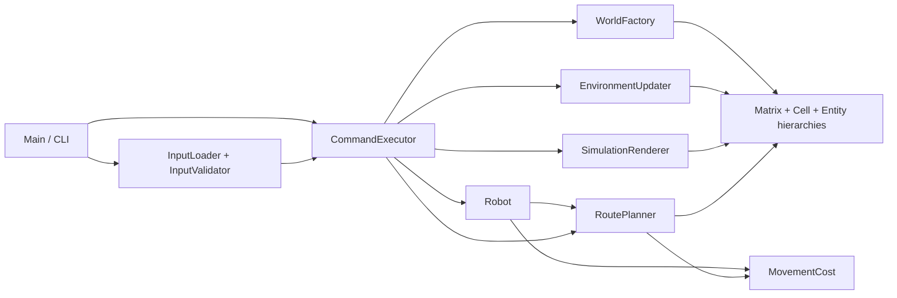

# TerraBot — Ecosystem Simulator

# Constantinescu Rares

TerraBot is a deterministic Java simulation of a robot exploring a grid ecosystem.
Air, soil, plants, animals and water influence the environment and the energy needed
to traverse it. Scanning unlocks ecological interactions; learned facts allow the
robot to improve its surroundings.

Originally developed for the Object-Oriented Programming course at POLITEHNICA
Bucharest. Original project credit: **CONSTANTINESCU RARES, 323CA**. The coursework
input files, reference outputs and checker remain in their original directories.

## What it does

- Runs multiple independent simulation sessions from one JSON scenario.
- Explores neighboring cells using environmental hazards to select a destination.
- Scans plants, animals and water, learns facts, and applies five environmental improvements.
- Simulates plant maturity, oxygen production, water effects, animal feeding and predation.
- Handles battery consumption, charging and climate-specific weather events.
- Plans minimum-energy routes and executes an affordable route as one command.
- Writes one structured JSON result per command, including errors for unavailable actions.

## Build and run

Requires **JDK 25** and **Maven 3.6.3 or newer**. No IDE configuration is needed.

```sh
mvn clean verify
java -jar target/terrabot.jar examples/route-planning.json out/routes.json
java -jar target/terrabot.jar input/test01_initialize_entities.json out/initialization.json
java -jar target/terrabot.jar --help
```

The executable JAR includes Jackson. Lombok is used only during compilation; JUnit,
AssertJ, JSON Unit, Checkstyle and JGit are test dependencies. Dependency versions and
build plugin versions are pinned in [pom.xml](pom.xml).

Exit status is `0` on success, `1` for input/output errors, and `2` for invalid CLI
arguments. A valid scenario can contain rejected commands; those errors appear in
its JSON results and do not make the file-processing command fail.

## Scenarios and commands

A scenario contains `simulationParams` and an ordered `commands` array. Each world
specifies `territoryDim` as **HEIGHTxWIDTH**, initial `energyPoints`, and
`territorySectionParams`. Coordinates are Cartesian: `(0, 0)` is the bottom left.
Every cell needs one air and one soil entry. Plants, animals and water are optional;
each cell holds at most one entity of each kind.

| Commands | Purpose / additional fields |
| --- | --- |
| `startSimulation`, `endSimulation` | Start the next world or end the active session |
| `printMap`, `printEnvConditions` | Inspect the whole grid or the robot's current cell |
| `moveRobot`, `getEnergyStatus` | Greedy neighboring movement or remaining energy |
| `rechargeBattery` | Recharge by `timeToCharge` points; actions are blocked until charging ends |
| `scanObject` | Identify by `color`, `smell`, `sound`; the string `none` marks an absent signal |
| `learnFact`, `printKnowledgeBase` | Save `subject` (the fact) for `components` (the discovered entity) or list facts |
| `improveEnvironment` | Apply `improvementType` using discovered `name` and the required fact |
| `changeWeatherConditions` | Apply a climate-specific event using `type` and its event parameters |
| `planRoute`, `moveTo` | Preview or execute a route to integer `targetX`, `targetY` |

All commands require a nonnegative, nondecreasing integer `timestamp`. Equal
timestamps are allowed. See [input/](input/) for complete examples of the original
commands and [examples/route-planning.json](examples/route-planning.json) for routing.

The improvement recipes are `plantVegetation`, `fertilizeSoil`, `increaseHumidity`,
`waterRetention` and `increaseMoisture`. Facts use the original assignment's recipe
strings; for example, `Method to plant Rose`. The humidity recipe accepts
`Method to increase humidity` with or without a final period.

### Route planning example

The example starts with 30 energy points and moves to `(0, 1)` for 3 points. Its next
commands inspect and traverse a route to `(2, 1)`:

```json
{"command":"planRoute","targetX":2,"targetY":1,"timestamp":2}
```

The route command's `output` is:

```json
{
  "energyCost": 12,
  "steps": 4,
  "affordable": true,
  "path": [[0,1], [0,2], [1,2], [2,2], [2,1]]
}
```

The direct two-step path would cost 42 points because of the wet central cell.
`moveTo` follows the same least-cost route and leaves 15 points. Insufficient energy
rejects the entire movement without changing position or battery. Planning does not
change either value. Normal time progression still occurs before each command.

## Architecture



`CommandExecutor` owns session transitions and command dispatch. `WorldFactory`
constructs independent entities for every occupied coordinate. `EnvironmentUpdater`
advances the ecosystem one tick at a time, and `SimulationRenderer` defines the JSON
schema explicitly. Domain getters do not become output fields automatically.

The `Entity` hierarchy retains species-specific polymorphism for environmental
quality, oxygen output, attack probability and weather response. Entity attachment
dispatches to the appropriate slot in a `Cell`. Grid dimensions and cell coordinates
are fixed; routes and positions are immutable values. Inventory access returns
immutable snapshots, including nested fact lists.

## Implementation decisions

- **One movement formula:** local exploration and routing use the same rounded
  hazard mean. Local ties follow north, east, south, west. Dijkstra uses a stable
  discovery-order tie break and supports zero-cost cells. Route totals use `long`;
  individual cell costs saturate at the integer energy limit. On a grid of `V`
  cells, routing takes `O(V log V)` time and `O(V)` additional space.
- **Separate ecological rhythms:** scanned animals interact with their current cell
  each tick and move every two ticks after scanning. Water effects also use the
  individual water object's scan time. Consumed animals cannot reappear through
  stale tracking references. Predation clears an occupied destination before movement,
  including after feeding on the current cell. Plant lifecycle state is represented
  by one enum.
- **Weather belongs to each air instance:** modifiers survive ecological
  recalculation, expire after two ticks, and keep quality within `[0, 100]`.
  Later events in another climate do not extend an earlier event.
- **Snapshot navigation:** `moveTo` executes at one timestamp. Intermediate cells
  contribute energy cost; traversal does not scan objects or advance time per step.
  A later command recalculates its route against the then-current world.
- **Validate before execution:** malformed documents, unknown types or commands,
  incomplete coverage, duplicates, invalid coordinates and missing command fields
  produce input errors. Duplicate JSON keys, trailing documents and nonfinite
  numbers are rejected. Limits are 10 MiB per file, 100,000 cells per world,
  timestamp 100,000, and 10,000,000 cell-work units per scenario. Cell-work counts
  elapsed ticks times active world size, plus one world-size unit for each map or
  route command.
- **Complete output replacement:** results are serialized to a sibling temporary
  file before replacement. Replacement is atomic when supported by the filesystem.
  Failed validation or execution leaves an existing result untouched. Entity mass
  is rounded to two decimal places only at the JSON boundary.

## Testing

```sh
mvn clean verify
mvn -Passignment-history clean verify
```

The default suite has **109 tests**, including all **21 unchanged coursework
input/reference pairs**. It covers session isolation, invalid inputs, battery
boundaries, ecological timing, predation, output handling and route execution.
Dijkstra's distances are compared with an independent Bellman–Ford implementation
for **360 origin/destination cases across 40 seeded worlds**.

The `assignment-history` profile additionally runs the original Git commit-count
grading test, for **110 tests**. Only that history-dependent check is excluded from
the default suite so source archives and shallow checkouts can build. The original
checker also prints its academic point total; the Surefire summary reports test
success. Reports are written to `target/surefire-reports/`.

[GitHub Actions](.github/workflows/verify.yml) runs the default build and the routing
example on JDK 25. No performance benchmark or throughput claim is included.

## Limitations

This is an educational ecosystem model with heuristic formulas, not a validated
biological simulation. Scanning classifies signal combinations rather than matching
species-specific sensory data. Knowledge is kept in memory and resets between
sessions. The application processes complete JSON files and stores results in
memory; the documented input and work limits bound supported scenarios. There is
no interactive UI or checkpoint persistence.
